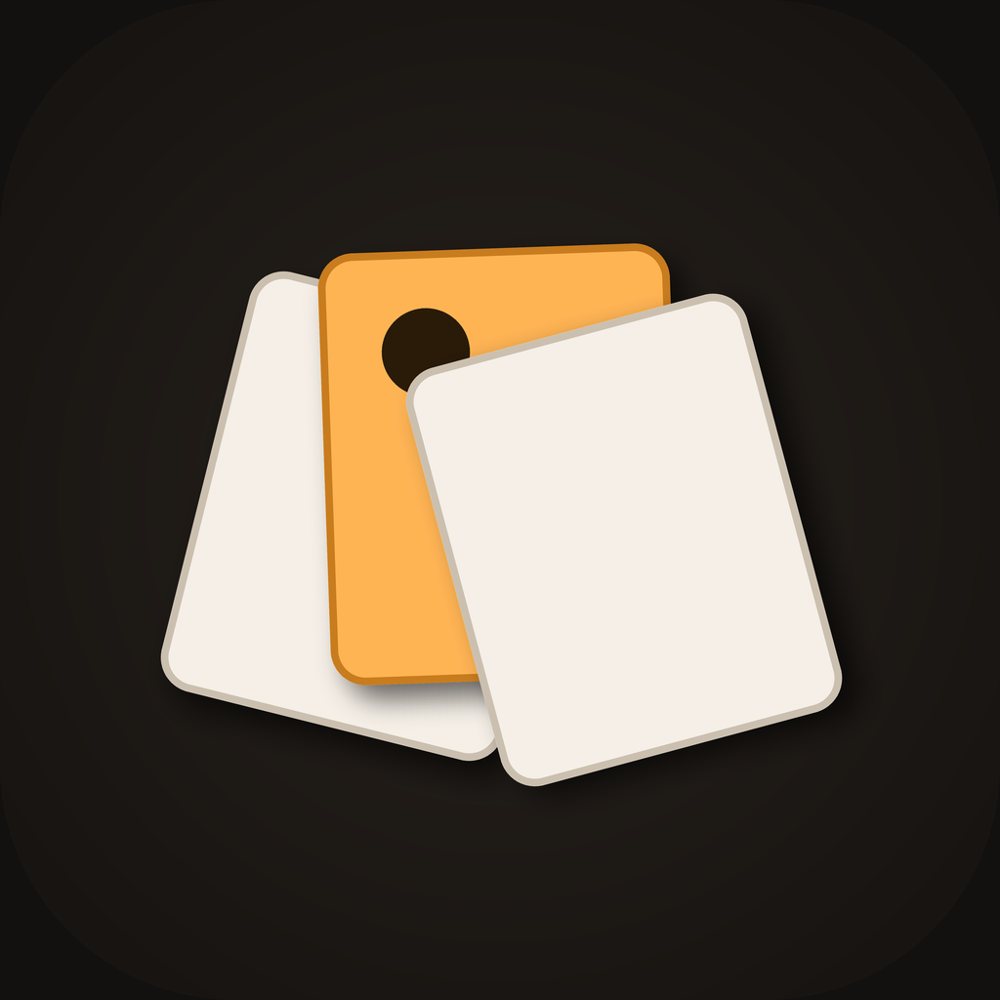

<div align="center">
  
  <h1>Collage</h1>
  <p><b>A photo collage maker where you place every photo yourself.</b><br/>A free, dark-mode Android app that puts you in control of every slot — no autofill.</p>
  <p>
    <a href="LICENSE"></a>
    
    
    
    
  </p>
</div>

---

A free, dark-mode photo collage maker for Android where **you** decide which photo goes in which slot. Unlike PicCollage-style apps that autofill for you, Collage puts you in control of every placement.

## Features

- Manual slot assignment with drag-to-swap between slots
- Curated and custom layout templates, each labelled with its aspect-ratio numbers
- Freeform canvas: move, scale, and rotate every element
- Stickers across 9 categories
- Shapes, text, and emoji
- Giphy GIF search
- Backgrounds: solid, gradient, pattern, or image
- Live border and spacing controls
- High-resolution PNG export straight to your gallery
- Re-editable saved collages in "My Collages"
- AI auto-collage suggestions
- First-run onboarding and coach-marks to get you started
- Dark mode only

## Install the APK on Android

1. Open the [GitHub Releases page](../../releases) and download the latest `app-release.apk`. If you prefer a smaller download, grab the ABI-specific file that matches your phone instead. `arm64-v8a` fits most modern phones.
2. On your phone, open the downloaded file.
3. When prompted, allow "Install unknown apps" for the browser or file manager you used to download it.
4. Finish the install, then open Collage.

## Giphy GIF search (optional)

GIF search is powered by the Giphy API. Without a key, the rest of the app works normally and the GIF tab simply shows a friendly message.

To enable it:

1. Get a free API key at [developers.giphy.com](https://developers.giphy.com).
2. Build or run with the key passed in:

   ```
   flutter run --dart-define=GIPHY_API_KEY=your_key
   ```

   For release builds, set the `GIPHY_API_KEY` GitHub secret instead.

Never commit a real key to the repository.

## AI auto-collage (optional)

The AI suggestion feature needs an API key supplied via a dart-define:

```
flutter run --dart-define=AI_API_KEY=your_key
```

For release builds, set the `AI_API_KEY` GitHub secret. Without a key, the feature shows a clear message and everything else — including making collages by hand — works fully.

## Build it yourself

```
flutter pub get
flutter build apk --release
```

The `--dart-define=GIPHY_API_KEY=...` and `--dart-define=AI_API_KEY=...` flags are optional; add them if you want GIF search and AI suggestions enabled in your build.

## Releasing

Maintainers publish a new version by pushing a git tag:

```
git tag v1.0.0
git push origin v1.0.0
```

This triggers the GitHub Actions workflow that builds the APKs and publishes a GitHub Release with them attached.

## Tech

Flutter, Riverpod, photo_manager, permission_handler.

## License

The code is licensed under the [MIT License](LICENSE) © 2026 Olivier Lüthy. You're free to use, modify and distribute this software, including commercially, as long as the copyright notice and license are included. Bundled sticker assets are released under CC0 — see [docs/ASSETS.md](docs/ASSETS.md) for details. For the design system, see [docs/STYLEGUIDE.md](docs/STYLEGUIDE.md).

## Author

Built by **Olivier Lüthy** — [GitHub](https://github.com/olivierluethy).
